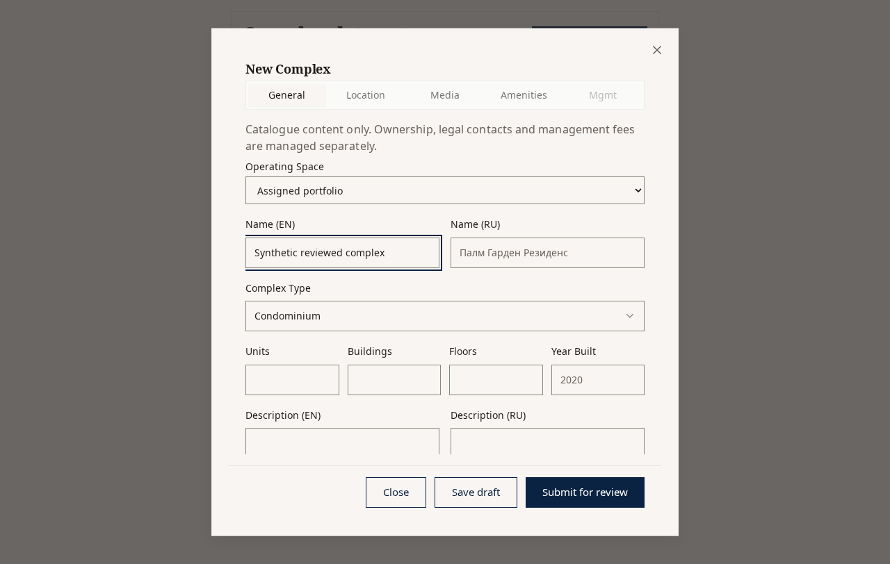
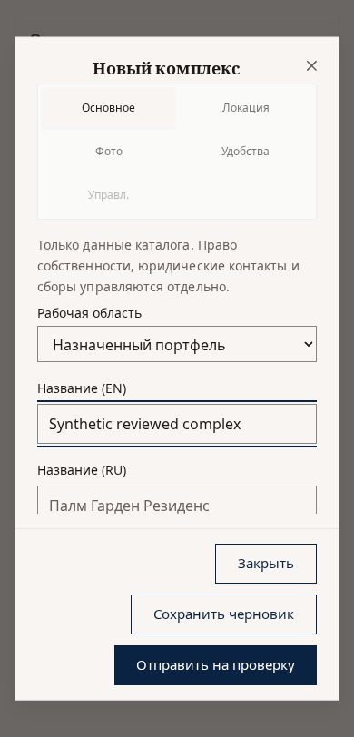

# Admin acceptance evidence — 20 November 2026

Repository `pavel949/myuno`. The local source baseline was `dcb70408de29faef9fa780f72fdf88b86c542107`. New source-policy tests were accepted in [PR #293](https://github.com/pavel949/myuno/pull/293), merged as `ba4a7b248c4a3c67f690fc803760490f733a0ae0`.

## Contents

- `complex-form/` contains 36 screenshots and the 12-case RU/EN/TH × 375/390/430/1280 px result matrix from the existing complex authoring/review fixture.
- `admin-tools/` contains 14 screenshots and two result JSON files from the existing administrative-tools browser fixture at 390 and 1440 px.
- `logs/` contains the 80-case administrative component/hook run, 188-case PostgreSQL publication run, eight-case catalogue relation run, focused/full TypeScript command output and scoped lint output.

Every screenshot uses synthetic fixture data. No authenticated production information is included. All 50 image blobs were verified against the original Git blob SHA before creating this PR. JSON and log files are retained as UTF-8 text.

## Interpretation

The 276 local checks and 26 browser scenarios passed in their stated isolated environments. They establish the tested source contracts. The existing publication suites include candidate SQL; those results do not establish its live activation. `property_complexes` and `property_projects` remain distinct domains.

The host denied Unix-domain sockets. Temporary local runners changed PostgreSQL transport to loopback while retaining the SQL, assertions and timeouts. CI used the committed Unix-only PostgreSQL test. System Chromium could not start in this environment. The existing browser assertions completed with temporary headless Chromium 153, software rendering and a fresh browser for each context. Browser scripts in the repository were retained. Full project TypeScript completed with a bounded 3 GiB heap after the default heap exhausted and an oversized retry was killed.

## Corroborating CI

All active gates passed on PR #293 head `28489f0ddff79908cf9b456131cd539a0e38a713`.

- [Verify](https://github.com/pavel949/myuno/actions/runs/44663910473)
- [Connected system](https://github.com/pavel949/myuno/actions/runs/44663910469)
- [Design system](https://github.com/pavel949/myuno/actions/runs/44663910462)

The manual E2E workflow was skipped by its existing configuration. The earlier source-equivalent test commit `2b658da` passed 522 files and 5828 tests in [Verify](https://github.com/pavel949/myuno/actions/runs/44661268998/job/136039811016).

## Reproduction and continuation

Use the existing commands and assertions in `scripts/qa/complex-authoring-ui.mjs`, `scripts/qa/complex-authoring-ui.py`, `scripts/qa/admin-tools-ui.mjs` and `scripts/qa/admin-tools-ui.py`, plus the tests named in the retained logs. Use local synthetic configuration and the network-denying fixtures. The existing Vite CSS compilation or the canonical stylesheet fixture supplies the CSS for the complex form.

[Issue #294](https://github.com/pavel949/myuno/issues/294) is the continuation checklist. It records the OAuth callback failure, missing authenticated CRUD/live-policy evidence and absent project deletion control. Each task should be closed only with evidence for the corresponding environment and version.

## Representative views

