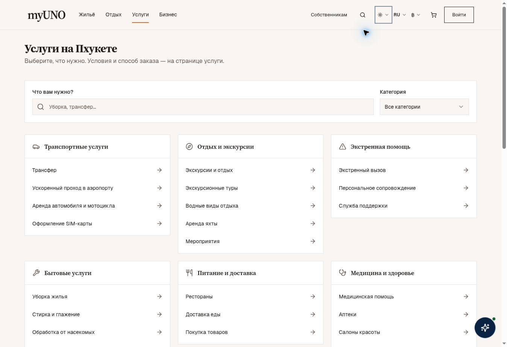
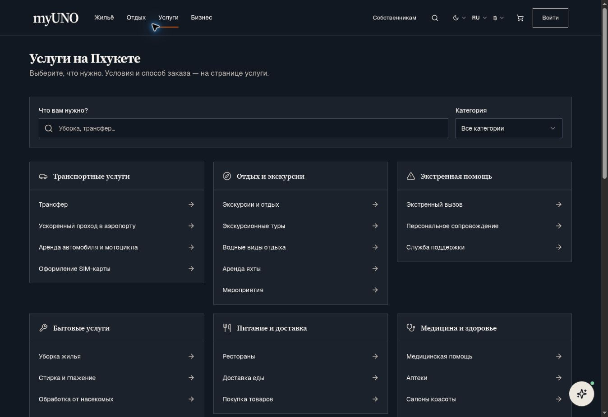

# Единый интерфейс myUNO: реализованный набор

База: `49d49c57c205e496aa8708c1a7f28caf2ef1dc7d`, актуальный main при начале реализации. Изменения относятся к репозиторию `myuno`.

## Пользовательская структура

| Поверхность | Реализовано |
|---|---|
| Публичный просмотр | Одинаковые пять мобильных назначений независимо от персон и прежних экспериментов: Главная, Жильё, Отдых, Услуги, Профиль. Специализированные рабочие пространства сохраняют свои меню. |
| Discovery услуг | `/discover` и `/discover/services` показывают общий поиск и категории с прямыми ссылками. Параметры `q` и `category` хранятся в URL; прочий контекст ссылки сохраняется. |
| Подбор по ситуации | Дополнительный путь `/discover/situations` открывает существующий Life OS; он больше не обязателен для поиска услуги. Динамические `/discover/:code` сохранены. |
| Аккаунт | `/me/services` использует тот же каталог без второй оболочки. На телефоне раздел выбирается общим Select, на десктопе остаются вкладки. |
| Поездка | PageShell → PageHeader → карточка поиска жилья → личный список подготовки. Дополнительные услуги и помощь собраны в отдельной карточке. |
| Поиск жилья | Одна читаемая колонка на телефоне, две на небольшом десктопе, три на широком. Убрана автоматическая подсказка о клике; фильтр компании назван «Все компании». Значение `panoramic` локализовано. |
| Общие каталоги | FeatureLayout имеет собственный контейнер, не добавляет второй внешний отступ. Дополнительный hero и пояснение об экосистеме включаются явно. |

Каталог услуг — навигационная проекция существующих `CATEGORIES`, а не новая база исполнителей. Статусы `soon` и `pro` не показываются как общедоступные услуги. Ссылка на направление не означает подтверждённые цену, наличие или мгновенное бронирование. Существующие REQUEST / BOOK / BOOK+PAY сценарии продолжают работать на страницах вертикалей.

## Дизайн-система и композиция

- `AppLayout` монтирует навигацию, аналитику и общие баннеры один раз. Вложенный AppLayout предоставляет только содержимое. Проверка родительского контекста вынесена во внешний компонент, поэтому внутренний не запускает повторные хуки.
- Подвал отображается только через `showFooter`. Автоматические приглашения установить приложение исключены из общей оболочки; отдельный `/install` остаётся доступен.
- Мобильное меню использует общий Radix Sheet: имя панели, фокус внутри, Escape, восстановление фокуса. Есть прямые ссылки на разделы, помощь и вход/аккаунт.
- PageHeader переносит длинный заголовок, подзаголовок и действия. UnifiedHeader показывает поле поиска только при наличии обработчика.
- Card использует единые фон, границу и состояния; Input и SelectTrigger имеют высоту 44 px. Все цвета наследуют действующие семантические токены светлой/тёмной темы.
- HomeDiscoverySearch самостоятельно определяет семантические переменные оформления, чтобы основная кнопка оставалась видимой вне прежнего hero-контейнера.
- Checkbox списка поездки имеет компактный индикатор внутри кликабельного label размером 44 px; общий мобильный min-height больше не вытягивает его в прямоугольник.

Это общий слой для существующих страниц, а не утверждение, что каждый специализированный экран переписан или визуально принят. В исходниках около 200 страниц используют AppLayout, 36 — MiniAppLayout; фактический охват зависит от композиции и явных переопределений.

## Проверки

- 119 тестов в 10 наборах прошли: навигация, ссылки каталога, URL/история/сброс поиска, пустой результат, модальное меню/Escape, композиция оболочек, выбор раздела аккаунта, таксономия, главная и передача параметров жилья.
- TypeScript: `node --max-old-space-size=4096 node_modules/typescript/bin/tsc --noEmit -p tsconfig.app.json` — успешно.
- Production build с тем же Vite-конфигом и PWA: `node --max-old-space-size=3072 node_modules/vite/bin/vite.js build` — успешно. Первый стандартный запуск с лимитом 8192 MB был остановлен средой по памяти; более низкий heap позволил завершить сборку. Алгоритм минификации и sourcemaps не менялись.
- Браузер: desktop 1348 px, мобильные iframe 375/390/430 px, светлая и тёмная темы каталога. На проверенных услугах, аккаунте, жилье и поездке: одна шапка, document scrollWidth равен clientWidth. У iframe системный scrollbar занимает 15 px внутри заданной ширины.
- Меню: Escape закрывает панель и возвращает фокус на «Открыть меню». Поиск, сброс и прямые переходы проверены. Готовые кадры проверены после окончания смены темы/анимации.
- Браузерная проверка — локальная реализация с чтением публичных данных. Авторизованные рабочие места и полный цикл бронирования/оплаты в этот визуальный проход не входят. Бизнес-записи для QA не создавались.

## Скриншоты реализации

[Телефон: светлая тема](unified-product-design/services-mobile-light.jpg) · [Телефон: тёмная тема](unified-product-design/services-mobile-dark.jpg) · [План поездки](unified-product-design/trip-mobile-light.jpg)

## Последующая приёмка

После интеграции проверить опубликованную версию, прямые ссылки и авторизованные пространства owner/MC/vendor/admin. Отдельные сложные редакторы, специализированные карты и коммерческие состояния требуют приёмки по реальным ролям. Изменения этого набора не являются подтверждением их полной готовности.
